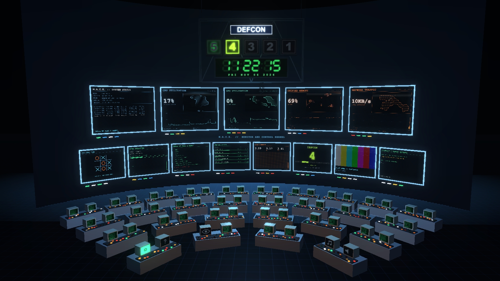
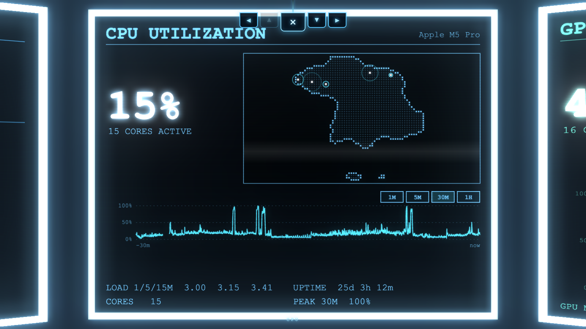
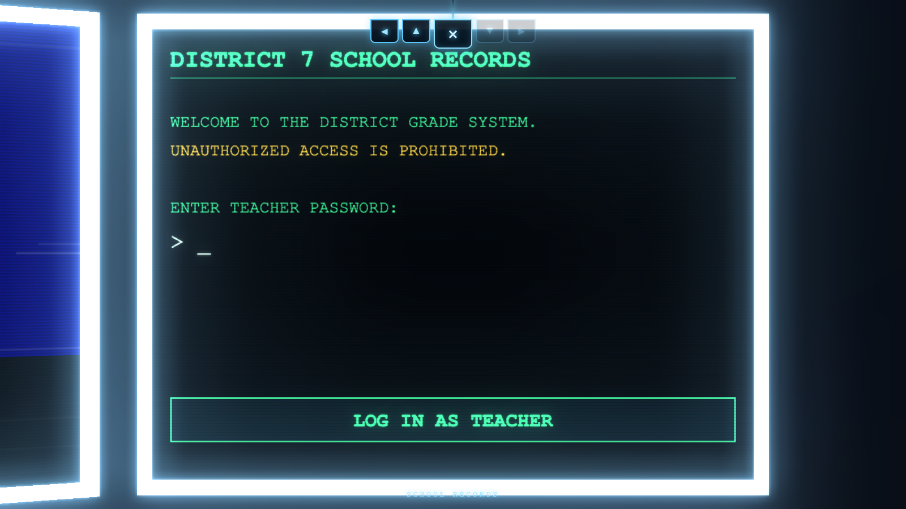
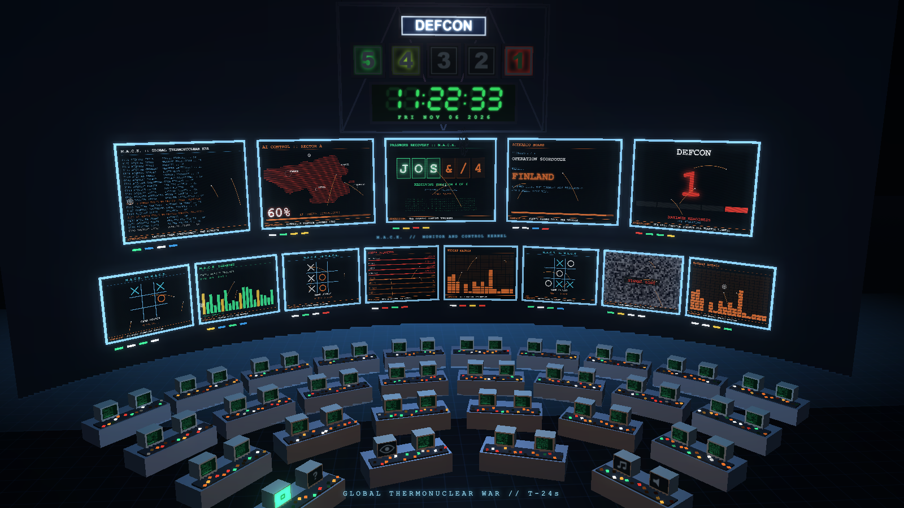

# M.A.C.K. — Monitor And Control Kernel

**Your Mac's CPU, GPU, memory, network and disk, shown as a 1980s war room.**

M.A.C.K. is a free macOS system monitor in two parts:

- a tiny **menu-bar readout** (`C 22%  G 0%  M 62%`, coloured green / yellow / red) that opens a compact dashboard, and
- a fully **3D war room**: a wall of glowing screens above rows of consoles. Click a screen and the camera flies in. Everything is live data from your own Mac.

It also has tic-tac-toe, a school-grades "hack", a 45-second *Global Thermonuclear War* light show, a slow "wonder walk" through the consoles, and a soundtrack. It is a love letter to the 1983 film *WarGames* and a place to look at your computer's vitals while feeling like a spy.



| Fly into any screen | Edit your grades | Global Thermonuclear War |
|---|---|---|
|  |  |  |

> Everything runs **locally**. No account, no cloud, no tracking. The server only listens on `127.0.0.1`, so nothing on your network can reach it. See [Privacy](#privacy).

---

## Install (about two minutes)

You need a Mac running a recent macOS (built and tested on macOS 26) with the **Xcode Command Line Tools** (they provide the Swift compiler and Python 3). You do **not** need the full Xcode app.

1. **Install the Command Line Tools** (skip if you already have them). Open *Terminal* and run:

   ```bash
   xcode-select --install
   ```

2. **Download M.A.C.K.** Either click the green **Code** button on GitHub and choose **Download ZIP** (then unzip it), or if you use git:

   ```bash
   git clone https://github.com/paytonhull/mack.git
   ```

3. **Build and open it.** In Terminal, go into the folder and run:

   ```bash
   cd mack
   ./build.sh
   open MacMon.app
   ```

A small readout appears in your menu bar. Click it for the dashboard, then click **WAR ROOM**.

**Just want to try it in your browser first?** No build needed:

```bash
cd mack
./run.sh
```

That opens the war room at <http://localhost:8765/war>. (The menu-bar icon needs the app build above.)

### If macOS complains

- *"Command not found: swiftc"*: run `xcode-select --install`, wait for it to finish, and try again.
- *The menu-bar item doesn't show up*: macOS hides menu-bar items on very crowded menu bars. Quit a few other menu-bar apps, or check there's room left of the clock.
- *"Address already in use" / blank dashboard*: something else is using port 8765. Quit it, or for the browser version run `PORT=9000 ./run.sh`. (The app build uses 8765.)
- *"MacMon can't be opened because it is from an unidentified developer"*: this shouldn't happen for an app you built yourself. If it does, right-click `MacMon.app`, choose **Open**, then **Open** again.

To stop it: click the menu-bar readout, right-click for the menu, and choose **Quit**.

---

## Using the war room

| Do this | To get this |
|---|---|
| **Click a screen** | Fly in. Buttons on the screen are clickable (zoom the history, sort processes, pick a game, …). |
| **◀ ▲ ▼ ▶** (or arrow keys) | Hop to the neighbouring screen. |
| **✕** (rolls down from the top) or **Esc** | Fly back out. |
| **`?` monitor** (front-left desk) or **H** | Help panel. |
| **Bracket monitor** (front-left desk) or **F** | Full screen. Handy for a second display. |
| **Eye monitor** (front-left desk) | **Wonder walk**: a slow ~2-minute stroll through the consoles, always looking up at the wall, on a loop. Click it again, press **Esc**, or click a screen to stop. |
| **Music / speaker monitors** (front-right desk) | Turn the background music and the sound effects on and off, separately. They light up when on. |
| **Games screen → last item** | **Global Thermonuclear War**: a 45-second show with a password cracker, missile launches, flashing screens and DEFCON 1. **Esc** aborts it. |

**The screens**

Top row: system status, CPU, GPU, unified memory, network traffic.
Bottom row: tic-tac-toe (it plays back), disk I/O, a games menu, top processes, load average, DEFCON, a live YouTube feed, and school records.

The **DEFCON board** above the screens follows your machine: the busiest of CPU, GPU and memory pressure sets the level (below 40% is DEFCON 5, above 90% is DEFCON 1). Press *Test alert* on the DEFCON screen to see it flash.

The clock above the screens is a real-time 24-hour clock with the date.

**The menu-bar app**

- Left-click the readout: the compact dashboard.
- Right-click: *Open War Room*, *Open in Browser*, *Quit*.
- History for the charts is kept for an hour and survives quitting and relaunching.

---

## How it works

```
 MacMon.app (Swift, AppKit)        server.py (Python 3, standard library only)
 ├─ menu-bar status item     ──►   ├─ samples CPU, GPU, memory, network, disk once a second
 ├─ popover  (WKWebView)           ├─ serves JSON at /api/stats
 └─ war-room window (WKWebView)    └─ serves index.html, war.html, three.js and the audio
                                          │
                                          ▼
                                 war.html  (three.js + WebAudio)
                                 3D scene, live screens, games, camera work, sound
```

- The Swift app starts `server.py` as a child process on `127.0.0.1:8765` and shows the pages in web views. It restarts the server if it ever dies and stops it when you quit.
- `server.py` reads stats with standard macOS tools (`host_statistics`, `vm_stat`, `ioreg`, `netstat`, `ps`). Nothing needs special permissions.
- The war room is one big HTML file drawing every screen onto a canvas texture in a [three.js](https://threejs.org) scene.
- The sound effects are real recordings (see credits) played through WebAudio; the camera hum and a few others are synthesised.

| File | What it is |
|---|---|
| `MacMon.swift` | The menu-bar app and war-room window |
| `server.py` | Stats sampler and tiny web server |
| `index.html` | The compact dashboard (menu-bar popover) |
| `war.html` | The 3D war room |
| `vendor/` | three.js r128 and its post-processing add-ons (bloom) |
| `audio/` | Music and sound effects |
| `build.sh` / `run.sh` | Build the `.app` / run in a browser |

You can run `server.py` on its own with `python3 server.py`. Environment variables: `PORT` (default 8765) and `MACMON_HOST` (shows a different name instead of your Mac's hostname, handy for screenshots).

**Compatibility.** Built and tested on Apple Silicon with macOS 26. The GPU reading comes from Apple's GPU counters and may show 0% on Intel Macs. Older macOS versions and Intel Macs are untested; reports are welcome.

---

## Privacy

- M.A.C.K. reads **only** basic system counters (CPU, GPU, memory, network and disk totals, and the names of your busiest processes) and shows them on screen.
- The server binds to `127.0.0.1` and is not reachable from other machines.
- Nothing is uploaded and there is no telemetry.
- The only data kept on disk is an hour of CPU/GPU/memory history at `~/Library/Application Support/MacMon/history.json`. Delete it any time.
- The one feature that touches the internet is the optional **Live Feed** screen, which embeds a YouTube video you choose.
- Your Mac's hostname appears on the system-status screen and the dashboard. Set `MACMON_HOST=anything` before recording a screen capture if you don't want it shown.

---

## Credits and licenses

- **M.A.C.K. code**: [MIT License](LICENSE).
- **three.js** (r128): MIT, © three.js authors. See `vendor/LICENSE-three.txt`.
- **Sound effects**: *Impact Sounds* by [Kenney](https://kenney.nl), CC0 (public domain). See `audio/fx/LICENSE-kenney-impact-sounds.txt`.
- **Music**: *The Final Count* and *Lingering Dissonance*, made with [Suno](https://suno.com). See [`audio/MUSIC.md`](audio/MUSIC.md).
- More detail in [`THIRD_PARTY_NOTICES.md`](THIRD_PARTY_NOTICES.md).

**Disclaimer.** M.A.C.K. is an unofficial fan tribute inspired by the film *WarGames* (1983). It is not affiliated with or endorsed by the film's makers or rights holders and contains no material from the film other than a few brief, well-known lines of dialogue. "WarGames" and any related names belong to their respective owners.

## Contributing

Bug reports, ideas and pull requests are welcome. See [CONTRIBUTING.md](CONTRIBUTING.md).
